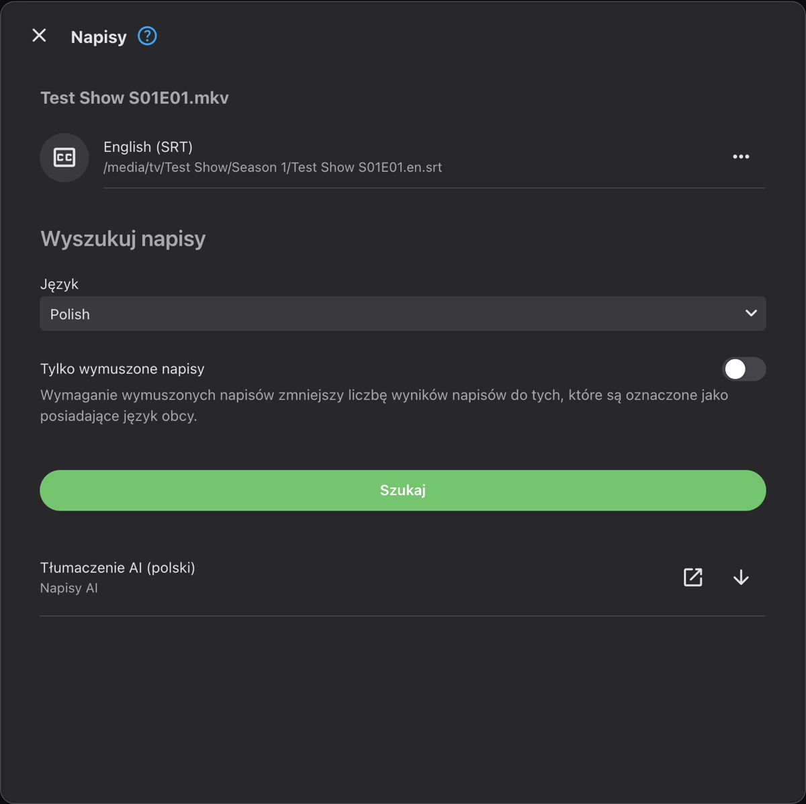
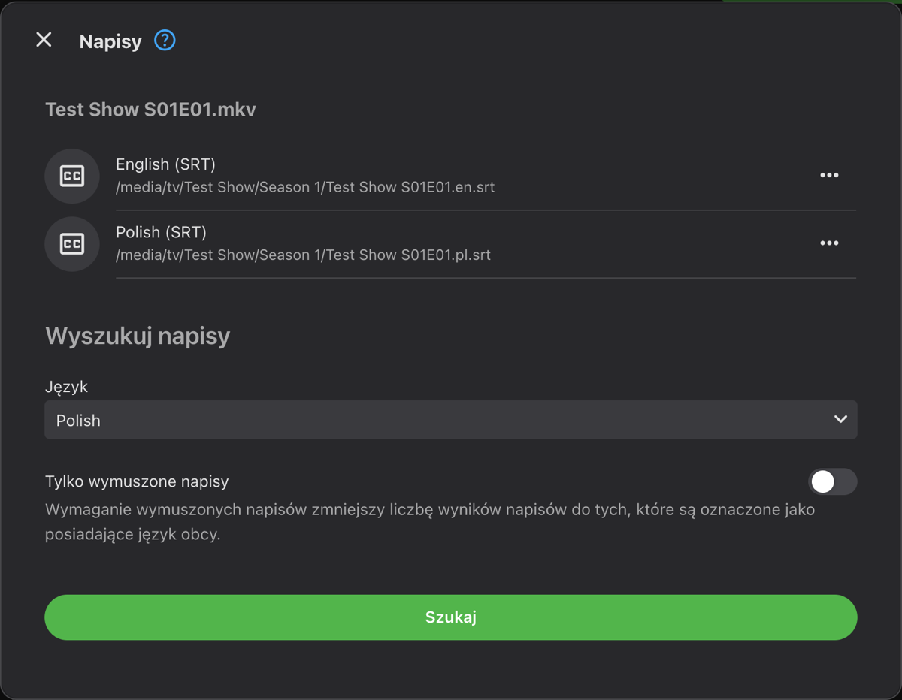
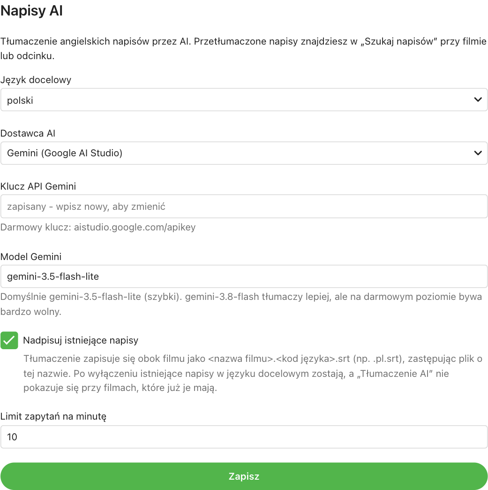

# Napisy AI - Emby plugin

[Polski](#polski) | [English](#english)

---

## Polski

Wtyczka do serwera **Emby**, która tłumaczy angielskie napisy na wybrany język (domyślnie polski) za pomocą AI. Przetłumaczone napisy wybierasz w Emby tak jak każde inne.

### Co potrafi

- W oknie **„Szukaj napisów”** przy filmie lub odcinku dodaje pozycję **„Tłumaczenie AI (polski)”**. Po jej wybraniu tłumaczy angielskie napisy i Emby zapisuje je jak napisy z każdego innego źródła. Tłumaczenie odcinka trwa zwykle 1-2 minuty.
- Zaplanowane zadanie **„Przetłumacz brakujące napisy”** (Panel → Zaplanowane zadania → Napisy AI) tłumaczy wszystkie filmy i odcinki, które mają angielskie napisy, a nie mają polskich. Domyślnie nie uruchamia się samo - uruchom je ręcznie albo ustaw harmonogram. Wtyczka nie reaguje na automatyczne pobieranie napisów przez Emby podczas skanowania biblioteki, więc nic nie tłumaczy się bez Twojej decyzji.
- Korzysta z napisów zewnętrznych (`.srt`, `.ass`, `.vtt`) i tekstowych wbudowanych w plik (MKV/MP4). Napisy obrazkowe (PGS, VobSub) nie są obsługiwane.
- Zachowuje czasy wyświetlania. Napisy zapisuje obok filmu pod tą samą nazwą: `<nazwa filmu>.<kod języka>.srt` (dla polskiego `.pl.srt`), więc każda aplikacja je skojarzy. Istniejący plik o tej nazwie jest zastępowany (opcja „Nadpisuj istniejące napisy”, domyślnie włączona; po wyłączeniu wtyczka nie rusza istniejących napisów w języku docelowym). Poprzedni plik jest odkładany na bok i wraca, jeśli Emby nie zapisze nowego.
- Rozpoznaje stare kodowania polskich plików (Windows-1250, ISO-8859-2).
- Dostawcy AI: **Gemini** (darmowy klucz), **Claude** oraz każde **API zgodne z OpenAI** (ChatGPT, OpenRouter, DeepSeek, lokalna Ollama).

### Jak to wygląda

**1. Szukaj napisów** - przy odcinku wybierz „Edytuj napisy”, ustaw język polski i kliknij „Szukaj”. Kliknij strzałkę przy „Tłumaczenie AI (polski)”:



**2. Gotowe** - przetłumaczone napisy leżą obok filmu pod tą samą nazwą (`Test Show S01E01.pl.srt`):



**3. Oglądanie** - polskie napisy są do wybrania przy odcinku i w odtwarzaczu:


**Ustawienia wtyczki** (Panel → Wtyczki → Napisy AI):



### Instalacja

1. Pobierz `NapisyAi.dll` (z wydania albo zbuduj: `./build.sh`, wynik w `dist/`).
2. Skopiuj plik do folderu `plugins` w danych serwera Emby, np.:
   - Docker: `/config/plugins/`
   - Linux: `/var/lib/emby/plugins/`
   - Windows: `%AppData%\Emby-Server\programdata\plugins\`
3. Uruchom ponownie serwer Emby.
4. Wymagany Emby 4.9.1.90 lub nowszy.

### Ustawienia

Panel → **Wtyczki** → **Napisy AI**:

- **Język docelowy** - domyślnie polski.
- **Dostawca AI** i **klucz API**. Zapisany klucz nie jest później pokazywany; puste pole przy zapisie oznacza „bez zmian”.
- **Model** - domyślnie `gemini-3.5-flash-lite` (Gemini; szybki - `gemini-3.8-flash` tłumaczy lepiej, ale na darmowym poziomie bywa bardzo wolny) i `claude-opus-5-5` (Claude; tańsze: `claude-sonnet-5-5`, `claude-haiku-5-5`).
- **Nadpisuj istniejące napisy** - domyślnie włączone.
- **Limit zapytań na minutę** - domyślnie 10, pod darmowy poziom Gemini.

#### Darmowy klucz Gemini

1. Wejdź na https://aistudio.google.com/apikey i zaloguj się kontem Google.
2. Kliknij „Create API key” i skopiuj klucz.
3. Wklej go w ustawieniach wtyczki i zapisz.

Klucz musi pochodzić z projektu na darmowym poziomie (Free tier) albo z projektu z doładowanym kontem - przy wyczerpanej przedpłacie wtyczka pokaże „Brak środków na koncie Gemini”. Na darmowym poziomie Google może wykorzystywać przesłane teksty do ulepszania swoich usług. Po wyczerpaniu dziennego limitu tłumaczenie kończy się komunikatem, a zaplanowane zadanie dokończy pracę przy następnym uruchomieniu.

### Koszty płatnych dostawców

Odcinek serialu to zwykle 600-800 kwestii. Orientacyjnie: Claude Sonnet ok. 0,15 USD za odcinek, Claude Opus ok. 0,30 USD, Claude Haiku i Gemini Flash-Lite kilka centów lub mniej.

### Prywatność

Do dostawcy AI wysyłany jest tylko tekst napisów i tytuł serialu lub filmu - bez ścieżek do plików i danych o użytkownikach.

### Budowanie

Wymagany .NET SDK 8:

```bash
./build.sh
```

---

## English

A plugin for **Emby Server** that translates English subtitles into a chosen language (Polish by default) using AI. You pick the translated subtitles in Emby like any others.

### Features

- Adds **"Tłumaczenie AI (polski)"** (AI translation) to the **Search subtitles** dialog of movies and episodes. Choosing it translates the English subtitles and Emby saves them like subtitles from any other source. An episode usually takes 1-2 minutes.
- Scheduled task **"Przetłumacz brakujące napisy"** (translate missing subtitles; Dashboard → Scheduled Tasks → Napisy AI) translates every movie and episode that has English subtitles but none in the target language. It has no trigger by default - run it manually or add a schedule. The plugin ignores Emby's automatic subtitle downloads during library scans, so nothing is translated unless you ask for it.
- Uses external subtitles (`.srt`, `.ass`, `.vtt`) and text subtitles embedded in MKV/MP4. Image subtitles (PGS, VobSub) are not supported.
- Keeps the original timings. Saves subtitles next to the video under the same name, `<video name>.<language code>.srt` (`.pl.srt` for Polish), so every player picks them up. An existing file with that name is replaced ("Nadpisuj istniejące napisy" / overwrite existing, on by default; turn it off to keep existing target-language subtitles untouched). The previous file is moved aside and restored if Emby does not save the new one.
- Detects legacy encodings (Windows-1250, ISO-8859-2).
- Providers: **Gemini** (free key), **Claude** and any **OpenAI-compatible API** (ChatGPT, OpenRouter, DeepSeek, local Ollama).

### Screenshots

**1. Search subtitles** - on an episode choose "Edit subtitles", set the language to Polish and search. Click the arrow next to "Tłumaczenie AI (polski)":


**2. Done** - the translated subtitles sit next to the video under the same name (`Test Show S01E01.pl.srt`):


**3. Watching** - the Polish subtitles can be picked on the episode page and in the player:


**Plugin settings** (Dashboard → Plugins → Napisy AI):


### Installation

1. Get `NapisyAi.dll` (from a release, or build it with `./build.sh`; output in `dist/`).
2. Copy it into the `plugins` folder of your Emby data directory, e.g.:
   - Docker: `/config/plugins/`
   - Linux: `/var/lib/emby/plugins/`
   - Windows: `%AppData%\Emby-Server\programdata\plugins\`
3. Restart Emby Server.
4. Requires Emby 4.9.1.90 or newer.

### Settings

Dashboard → **Plugins** → **Napisy AI**:

- **Target language** - Polish by default.
- **AI provider** and **API key**. A saved key is never shown again; leaving the field empty keeps it.
- **Model** - defaults `gemini-3.5-flash-lite` (Gemini; fast - `gemini-3.8-flash` translates better but can be very slow on the free tier) and `claude-opus-5-5` (Claude; cheaper: `claude-sonnet-5-5`, `claude-haiku-5-5`).
- **Overwrite existing subtitles** - on by default.
- **Requests per minute** - 10 by default, for the Gemini free tier.

#### Free Gemini key

1. Go to https://aistudio.google.com/apikey and sign in with a Google account.
2. Click "Create API key" and copy it.
3. Paste it into the plugin settings and save.

The key must come from a free-tier project or a project with credit - with depleted prepayment the plugin reports "Brak środków na koncie Gemini" (no credit). On the free tier Google may use submitted text to improve its products. When the daily quota runs out, translation stops with a message, and the scheduled task finishes the remaining items on its next run.

### Paid provider costs

A TV episode usually has 600-800 subtitle lines. Rough cost: Claude Sonnet about USD 0.15 per episode, Claude Opus about USD 0.30, Claude Haiku and Gemini Flash-Lite a few cents or less.

### Privacy

Only the subtitle text and the show or movie title are sent to the AI provider - no file paths and no user data.

### Building

Requires the .NET 8 SDK:

```bash
./build.sh
```
